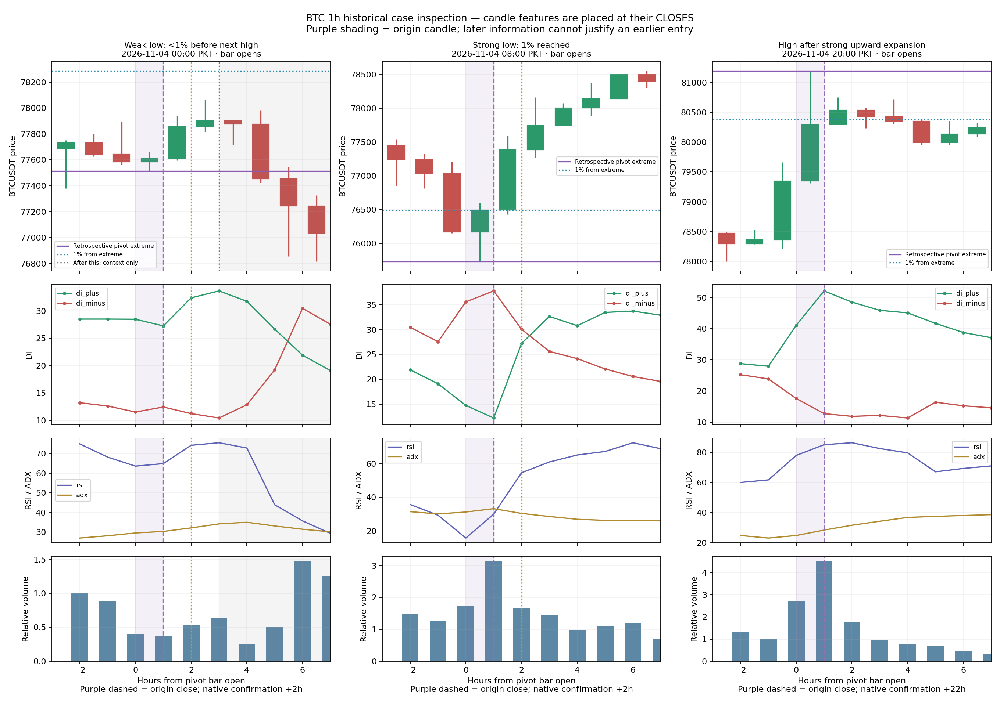

# BTC 1-hour pivots: three actual cases

Start with the **1-hour timeframe**, as requested. This is a review of frozen
uploaded history through **5 November 2026, 21:00 PKT**, not a live chart reading
for 6 November. All times below use Pakistan time; UTC equivalents help locate
the same candles on a UTC chart.

The full 1h study contains 25,893 native pivots: 12,946 lows and 12,947 highs.
About 64.22% of resolved lows and 63.39% of resolved highs reached the retrospective
1% benchmark. Around 73% of those successful moves had already reached 1% by
formal recognition. These are ideal-extreme swing outcomes, not executable trade
win rates. Three cases below illustrate different paths, not a representative
validation sample.



Candles span their actual hour. DI/RSI/ADX/volume observations are placed at their
**closes**, not at the bar's opening time. Purple shading is the pivot-origin
candle; the dashed purple line is its close. Gray shading in the first case is
after the measured next-opposite-pivot candle and is context only. Gold dotted
lines indicate native confirmation when it falls inside the visible window.
The high's +22h native confirmation is outside the window. Native `known_time`
is reconstructed recognition from the stored event, not proof of actual live
notification delivery.

## A small low: 4 November 00:00 PKT (3 November 19:00 UTC)

Pivot low: **77,512.01**. The following high was **78,063.30**, giving only
**0.711%** before the next opposite pivot. It is a non-hit for this specific 1%
benchmark, not automatically a losing or useless trade.

At the origin candle close, 01:00 PKT:

- Relative volume was **0.379x**, with the preceding candle also quiet (0.402x).
- DI+ was **27.26**, already above DI− **12.45**.
- RSI was **64.91**, rather than an exhausted low-RSI downside move.
- The candle ranged only about **0.43 ATR**.

This was a relatively quiet small pullback while DI+ already dominated. It should
not be assumed to have the same event sequence as an exhaustion/rejection low.
The native low was recognized at 02:00 PKT, as the next high's candle opened.

## A strong low: 4 November 08:00 PKT (03:00 UTC)

Pivot low: **75,736.38**. The three relevant hourly observations were:

| Candle opens PKT | Close available PKT | Close | DI+ | DI− | RSI | Relative volume |
|---|---|---:|---:|---:|---:|---:|
| 07:00 | 08:00 | 76,170.85 | 14.76 | 35.57 | 15.74 | 1.723x |
| **08:00 pivot candle** | **09:00** | **76,496.04** | **12.23** | **37.77** | **29.97** | **3.137x** |
| 09:00 | 10:00 | 77,390.01 | 27.22 | 30.06 | 54.58 | 1.686x |
| 10:00 | 11:00 | 77,748.09 | 32.64 | 25.61 | 60.99 | 1.438x |

At the actual bottom candle, **DI− was still rising**, and DI+ was still falling.
A lower-price extreme, a substantial lower wick, an upward close, recovering RSI
and high activity developed together. The origin candle range was about 1.72 ATR.
A simple rule requiring DI− to have peaked or DI+ to have crossed above it could
therefore miss the original low.

By the origin candle's close, price was already **1.003% above the low**. At
10:00 PKT, the three-candle DI− peak could be confirmed and the native pivot was
recognized; price was already **2.183% above the low**. DI+ crossed above DI−
only in the candle closing at 11:00, when price was **2.656% above the low**.
Those percentages are movements from an ideal retrospective extreme, not returns
from an available fill.

This example motivates studying early recognition within a developing 1h
location. It does not prove an entry was available at 75,736.38. Finding an earlier
observable event would require a separate lower-timeframe/intrabar replay; final
hourly values cannot be assigned to an earlier minute inside that hour.

## A high: 4 November 20:00 PKT (15:00 UTC)

Pivot high: **81,196.01**. At the origin candle close, 21:00 PKT:

- DI+ reached **52.15**, versus DI− **12.77**.
- RSI was **85.13** and relative volume **4.510x**.
- Price closed at **80,296.01**, already **1.108% below the high**.

On the next candle, DI+ fell to **48.56**, yet the close **rose to 80,538.01**.
RSI also rose to **86.44**. Thus, a DI+ decrease was not the same thing as a
falling close or immediate price failure. Later hourly closes weakened, while
DI+ continued declining. The recorded native high was recognized only on
**5 November at 18:00 PKT**, +22h after its origin bar opened. That is a concrete
example of why formal native pivot recognition is not a suitable early-exit gate.

This high's subsequent swing remains incomplete in the frozen report. Its
observed 1% hit is real within the recorded price path, but its full eventual
outcome is unknown. The report's high-to-low excursion is not a completed trade
return or a guaranteed sell opportunity at the high.

## What to carry forward

On 1h, first distinguish a quiet pullback, a downside rejection and an upward
expansion/rejection. Their DI starting states and price responses differ.
Candidate pivots provide location/confluence; they do not independently trigger
an entry. A DI peak or crossover is timing evidence whose recognition delay must
be measured, and a DI decrease need not mirror a price decrease.

The next research question is the earliest observable price/DI event within each
setup, not another universal confirmation rule. These examples do not establish
that their specific indicator values are optimal cutoffs. Existing structure
labels still require the separate defect review; no live rules or formulas were
changed here.

Reproduce with:

```sh
MPLCONFIGDIR=/tmp/tradingbot-pivot-matplotlib python3 research_reports/BTC_1h_case_review/reproduce.py
```

`cases.json` retains the native events, selected candle windows, source hash and
timezone for inspection. Data comes from the existing report's overlapping frozen
contexts, with overlap consistency and each raw pivot extreme checked. No market
database is opened and no live analysis is recalculated.
