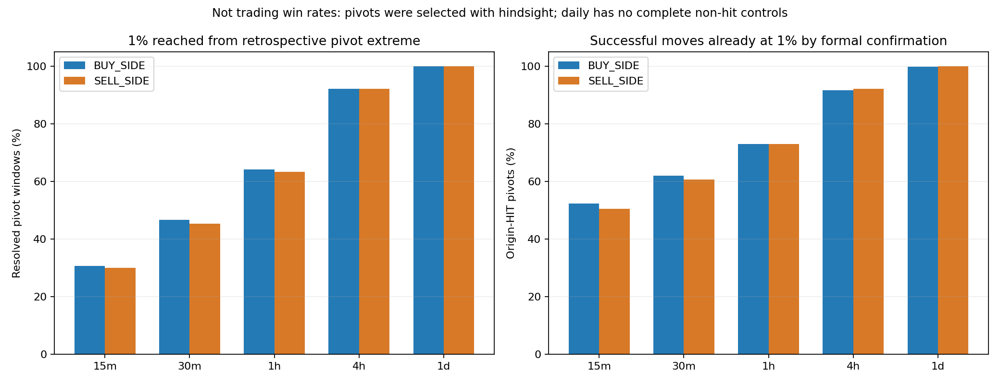
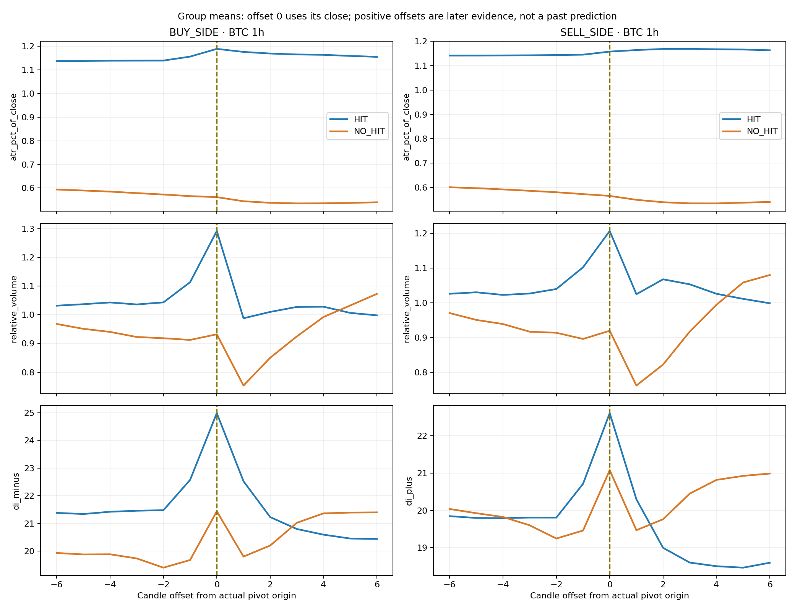

# What the five-timeframe BTC pivot study found

**Yes: the activity identified useful conditions and a substantial confirmation
delay. It did not establish an executable entry/exit rule.**

All 15 uploaded artifacts through Git commit `8111d18` were read. The analysis
covers **187,926 native pivots**, with 700 numeric feature names per timeframe.
The exported raw-price checks match every pivot price to its candle high/low. The source reports contain
zero invalid-event rows and zero missing-origin candles. Original reports are
preserved. `statistics.json.gz` contains source hashes, predefined profiles,
annual consistency checks and exploratory effects for all numeric fields.

## 1. The benchmark becomes much easier on larger timeframes

Percentages exclude incomplete windows. They measure 1% excursions from ideal
retrospective pivot extremes on subsequent candles until the next opposite pivot,
**not trading win rates**.

| Timeframe | Pivots | BUY-side reached 1% | SELL-side reached 1% | Successful BUY moves already at 1% by confirmation | Successful SELL moves already at 1% by confirmation |
|---|---:|---:|---:|---:|---:|
| 15m | 103,128 | 30.61% | 29.98% | 52.34% | 50.47% |
| 30m | 52,459 | 46.64% | 45.38% | 61.99% | 60.70% |
| 1h | 25,893 | 64.22% | 63.39% | 72.99% | 72.89% |
| 4h | 5,556 | 92.17% | 92.08% | 91.58% | 92.18% |
| 1d | 890 | 100.00% | 100.00% | 99.77% | 100.00% |

Daily has 889 observed hits, no complete non-hits and one incomplete low. Thus,
1% is not a useful discriminator between good and bad **daily pivots** in this
sample. It is not a 100% profitable daily strategy: the pivots are identified
retrospectively, confirmation is later, and risk/cost/execution are not simulated.
The selected 1% benchmark remains unchanged.



## 2. Useful pivots tend to occur during activity and price extension

The following are **means at the actual pivot candle close** for BTC 15m. They
are descriptive differences, not entry thresholds.

| Measurement | BUY HIT | BUY NO_HIT | SELL HIT | SELL NO_HIT |
|---|---:|---:|---:|---:|
| ATR as % of price | 0.769% | 0.334% | 0.749% | 0.336% |
| Relative volume | 1.406x | 1.053x | 1.283x | 1.034x |
| Candle range / ATR | 1.297 | 1.051 | 1.196 | 1.015 |
| Absolute distance from EMA50 | 1.298% | 0.455% | 1.210% | 0.471% |
| Absolute DI spread | 15.754 | 11.845 | 14.494 | 11.642 |
| ADX | 31.882 | 28.035 | 31.494 | 28.048 |

The volatility, volume, extension, DI-spread and ADX differences were positive
within each of the ten eligible calendar years on 15m and 30m. On 1h they were
positive in each of nine eligible years. An eligible year needs at least 30
available HIT and NO_HIT observations for that side/feature/offset. Daily has no
such comparisons; 4h has only a few eligible years because non-hits are scarce.
This consistency is descriptive and is not an untouched validation period.

Importantly, some differences were visible **one candle before the pivot**:
15m BUY HIT versus NO_HIT mean ATR% was 0.745 versus 0.333, RVOL 1.179 versus
0.981, EMA50 distance 1.320% versus 0.472%, and absolute DI spread 14.590 versus
11.507. Their directions were consistent in all ten eligible years. This makes
these useful *readiness/context candidates*, rather than evidence that only
appears after the rebound.

There is substantial confounding: a fixed 1% target is mechanically easier when
volatility and prior swings are larger. Distance from averages also grows with
volatility. Annual comparisons do not establish an independent location effect,
a reversal cause, or performance after matching on ATR and regime. The EMA50
distance is **absolute**; it does not prove lows were always below the average
or highs above it. Historical swing-distance fields are measurements, not promised
targets, and structure-derived inputs require the existing defect review.



## 3. A DI peak by itself does not distinguish the good pivots

At one candle after 15m pivot lows, the fraction with a newly confirmed DI−
peak was **64.18% for HIT versus 64.12% for NO_HIT**. After 15m pivot highs,
newly confirmed DI+ peaks were **63.24% versus 63.07%**. These near-equal
frequencies do not support treating that event alone as a quality filter.
At the pivot close, differences existed but were small: DI− peak confirmation
at lows was about 18.8% versus 16.3%; DI+ peak confirmation at highs about 18.0%
versus 16.5%. Independent DI events can still be useful for timing; a sequence
combined with context requires a separate test. These observations are conditional
on retrospective pivots and do not count DI peaks at every non-pivot candle.

At 15m lows, useful points had higher mean DI− (26.05 versus 23.18) and lower
mean DI+ (16.54 versus 18.34). But at highs, **DI+ dominance itself was not more
common among hits**: 59.27% versus 60.08% among non-hits. Thus the sell side
should not simply be a mirrored buy rule, and a dominance check alone cannot
supply the desired discrimination. Nothing here validates a universal spread
35/40 threshold or requires both DIs to turn together.

A more useful **follow-through hypothesis** is visible across intraday group
trajectories: after the first drop, the opposing DI tends to keep weakening in
HIT groups, whereas it often rebuilds in NO_HIT groups. For BTC 1h, mean values
at origin / +1 / +2 / +3 candles were:

| Side / pressure | HIT trajectory | NO_HIT trajectory |
|---|---|---|
| BUY / DI− | 24.99 → 22.53 → 21.23 → 20.80 | 21.44 → 19.80 → 20.20 → 21.03 |
| SELL / DI+ | 22.61 → 20.30 → 19.00 → 18.60 | 21.08 → 19.47 → 19.76 → 20.45 |

These are marginal group means, not proof that every case follows that sequence
or a measurement of conditional recognition accuracy. Waiting until +2/+3 to
enter could reproduce the late-entry problem: much of the 1% move is often
already over. A reasonable next hypothesis is to test pressure rebuilding plus
price failure as **post-entry invalidation**, alongside an independent early
entry event. That is not a validated exit rule, and these aggregate reports
cannot establish the joint per-case event sequence.

Wick proportions and rejection flags were also common in both groups. For
example, mean lower-wick fraction at 15m lows was 41.5% versus 39.9%. A candidate
pivot or rejection wick remains contextual evidence, not proof of a useful turn.

## 4. Waiting for formal pivot confirmation often loses the target

The table above directly supports the concern about late confirmation. On 1h,
roughly **73% of successful pivots had already reached 1% by confirmation**.
Moreover, among 1h origin-HIT lows, **2,120 / 8,307 (25.52%)** had already
recovered 1% by the origin candle's own close; for highs it was **1,594 / 8,205
(19.43%)**. Recognizing a candidate at the close of that candle is already late
for those particular ideal-extreme-to-1% moves.

The close-to-extreme diagnostic is separate from the benchmark, which retains
the original subsequent-candle convention. OHLC does not establish arbitrary
high/low order inside a candle or an executable fill at the pivot extreme.
`median_first_hit_following_bar` is a candle index, not an exact touch time.

## 5. Two context-quality limits remain

The legacy `current_structure` field is effectively stuck: on 15m, all 103,124
nonblank origin labels are BULL; on 4h, all 5,539 nonblank labels are BEAR. Those
are not trustworthy regime distinctions. The previously staged structure
correction is still separate from production deployment. Do not use this field
to validate a new entry filter or inflate confidence until repaired history is
checked.

Independent Section 5 Regime/Trend history is also too thin for the intended
all-history analysis. At the last closed local candle before pivot origin,
Regime classifications are present for only 1 / 103,128 cases on 15m, 5 / 52,459
on 30m, 17 / 25,893 on 1h, 9 / 5,556 on 4h and 12 / 890 on daily. These are
coverage counts, not proof that those classifications were all strong or useful.
Engine READY describes the available producer, not years of historical coverage.
Legacy regime labels remain explicitly separate; they cannot substitute for
independent-engine validation. Individual aggregate profiles also cannot reveal
joint DI/location/volatility combinations or full event order case by case.

## 6. What to test next

A justified research direction is **active/extended location → early independent
DI/price event → confirmation or invalidation**, with separate BUY/SELL paths.
The already-observable volatility, activity and extension measurements can define
readiness; candidate pivots remain confluence. The event must be tested on *all
candidate bars*, including those that never became confirmed pivots, so false
positives and missed turns are visible. Include event memory for non-simultaneous
observations, actual recognition delay, distance from the true extreme and adverse
movement. Do not turn the displayed means into optimized live cutoffs.

15m/30m/1h provide both HIT and NO_HIT controls. Higher timeframes can supply
context once their versioned history is populated; the daily 1% result alone
cannot train a discriminating entry rule. Test promising sequences chronologically
on an isolated research dataset, then evaluate positions, costs, stop/trailing
ordering and fills separately. No winning entry rule, trade win rate or live
change is established by this activity.

## Reproduction and reporting correction

```sh
MPLCONFIGDIR=/tmp/tradingbot-pivot-matplotlib python3 analyze_btc_pivot_study.py
```

Plotting needs Matplotlib/NumPy; `--no-plots` uses the standard library only.
The analysis checks source/cohort identity, every raw pivot-price match, missing
controls and the ATR scale correction. It reports preselected profiles and
exploratory within-year effects for all numeric features; those many comparisons
are not presented as independently validated discoveries.

The original exporter accidentally stored the legacy ATR/price **fraction** and
derived 100*ATR/price **percentage** under the same `atr_percent` feature name.
The old viewer could therefore mix their scales. This analysis verifies equal
sample counts and the exact 100x relationship, then uses the percentage-valued
records under `atr_pct_of_close`. The exporter is corrected for future reports.
Original uploads, pivot outcomes, other feature measurements and live feature
formulas are unchanged. No rerun of the full five-timeframe study is needed to
recover the values used here.
