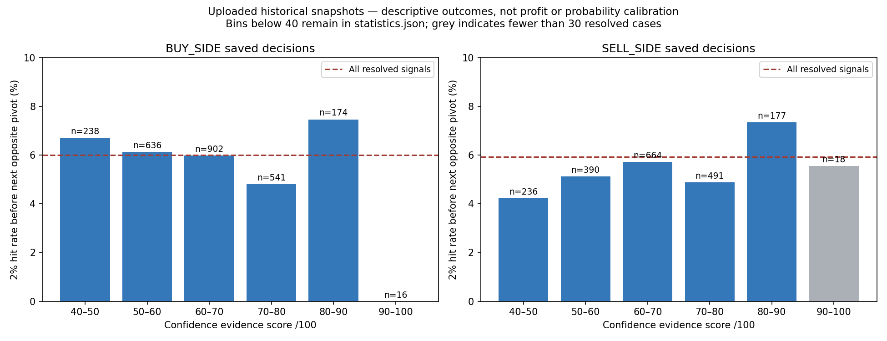

# Results from the uploaded BTCUSDT 15m audits

Sources: `BTCUSDT_15m_context_audit_v1.json.gz` (103,127 native pivots) and
`BTCUSDT_15m_saved_decision_audit_v1.json.gz` (5,061 saved decisions), uploaded in
Git through `f9aee59`. The original audit files are preserved.

Reproduce the statistics and figure with:

```sh
MPLCONFIGDIR=/tmp/tradingbot-matplotlib python3 research_reports/context_audit_v1_analysis/reproduce.py
```

## Confidence does not yet provide a reliable ranking for this outcome

Outcome here means a 2% directional high/low touch, starting at next-bar open and
ending at the next opposite pivot. It does **not** mean a profitable executed
trade or the success of a 0.5% stop/trailing strategy. SELL-side measures a
potential spot exit/rebuy decline, not a short trade.

| Saved Confidence score | BUY hits / resolved | BUY rate | SELL hits / resolved | SELL rate |
|---|---:|---:|---:|---:|
| 50–60 | 39 / 636 | 6.13% | 20 / 390 | 5.13% |
| 60–70 | 54 / 902 | 5.99% | 38 / 664 | 5.72% |
| 70–80 | 26 / 541 | 4.81% | 24 / 491 | 4.89% |
| 80–90 | 13 / 174 | 7.47% | 13 / 177 | 7.34% |
| 90–100 | 0 / 16 | 0.00% | 1 / 18 | 5.56% |
| All resolved saved decisions | 152 / 2,530 | 6.01% | 150 / 2,527 | 5.94% |

The 80–90 group is descriptively higher than baseline, but improvement is not
monotonic, and the highest group is small. These numbers do not validate a
threshold, establish statistical significance/generalization, or justify
interpreting 78/100 as a 78% probability. The full native-pivot cohort likewise
does not show consistent improvement as scores rise. Its outcome/selection
process differs from the saved-decision cohort, so the two must remain separate.

All 5,061 current-epoch saved snapshots matched the 5,061 stored decision rows;
there were no excluded model versions or anchors in this export. Two snapshots
lack compatible feature rows for this audit; their scores are not analyzed.
Four SELL outcomes are censored. Matching stored counts does not establish that
all historical signals have already been generated, that the user actually
received each snapshot live, or that this is an untouched out-of-sample period.
Some stored evidence is historical reconstruction. No feature repair or score
reweighting is inferred as validated from these descriptive results.



## Opportunity areas are distant relative to this swing horizon

Using the **original saved bands and inventory**, not scalar reconstructed bands:

| Saved-decision side | First forward area | Median distance from signal close | Median observed favorable move from next open | Median observed bars | First-area touch rate |
|---|---|---:|---:|---:|---:|
| BUY | Resistance | 1.184% | 0.331% | 3 | 241 / 2,461 = 9.79% |
| SELL | Support/rebuy | 1.142% | 0.348% | 4 | 286 / 2,514 = 11.38% |

Native and modeled areas are combined in this table; absent bands are excluded,
not counted as failures. Area distance uses the signal-close anchor whereas
favorable excursion uses next-open reference, so they are related diagnostics,
not identical return measures. The original engine also enforces 2-ATR clearance.

This suggests that these areas often describe broader barriers than the short
swing being studied. It does not prove their geometry is incorrect or that
moving them closer would improve trades. A touch is not proof of rejection.
Post-touch rejection/breakthrough measurements are retained per case, excluding
the ambiguous first-touch candle. A proper execution/position evaluation remains
necessary before using them as targets or stops.

## Regime/Trend comparison is incomplete

| Cohort | Local 15m usable Regime / Trend | 4h usable Regime / Trend | Daily usable Regime / Trend |
|---|---:|---:|---:|
| Native pivots | 0 / 0 | 175 / 175 | 751 / 751 |
| Saved decisions | 0 / 0 | 13 / 13 | 51 / 51 |

The 4h histories cover events from October 29, 2026 onward; daily histories from
October 3 onward. These are small recent subsets of a 2017–2026 cohort. They do
not support an all-history comparison or a general regime/trend trading gate.

Local histories were entirely hidden because the latest indexed live publication
was waiting for a feature checkpoint. This is partly an audit-reader limitation:
the latest-head readiness check was too restrictive for research of already
committed history. The research reader now allows an earlier indexed committed
prefix of the **same current producer**, with matching epochs/revision/run binding
and compatible feature generation. Missing exact closed candles remain missing.
Live readiness/runner behavior is unchanged; no old arbitrary run is substituted.

Use the context-refresh commands in `PIVOT_CONTEXT_AUDIT.md`. Refreshing joins can
recover existing history but cannot manufacture the missing years. If coverage
remains thin, independent analytical histories must be populated on isolated
research memory before making the requested regime-by-trend comparisons.

## Structure and next decision

The staged count>2 structure correction remains uninstalled in production.
Confidence continuation uses that family, so corrected feature history must be
validated before finalizing scores. Current scores are evidence measures, not
probabilities; the current reports do not establish predictive trading accuracy.

Next: recover available analytical context, inspect its coverage, then compare
repaired structure and regime/trend-conditioned DI behavior on research memory.
Do not add a new live Confidence threshold or change Opportunity spacing based
only on these aggregate observations.
