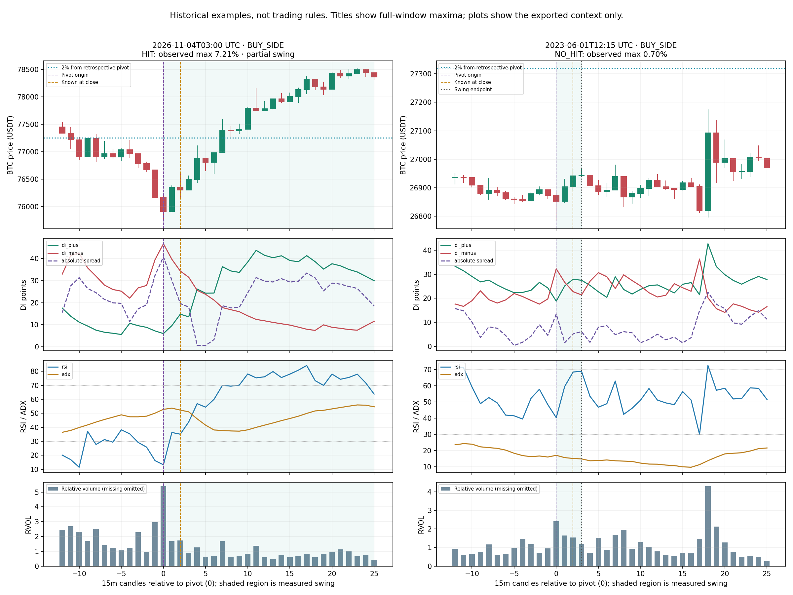
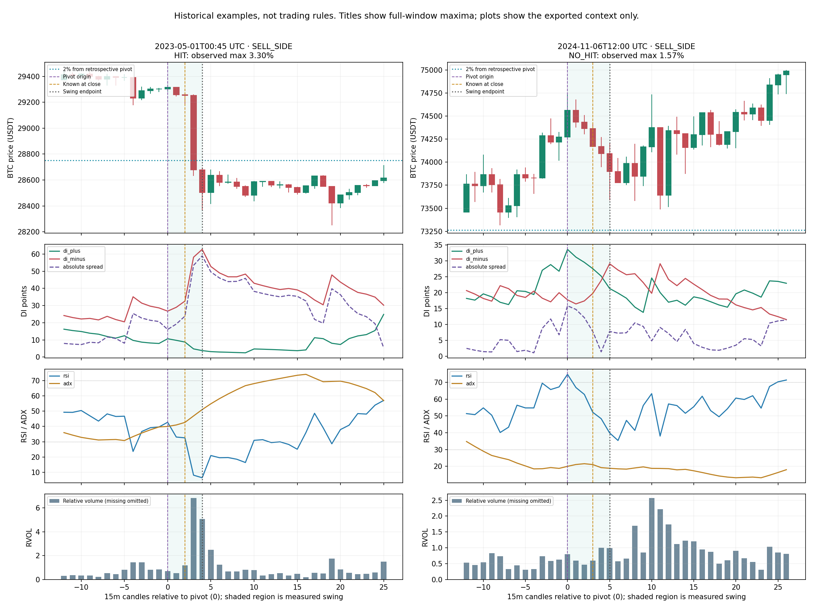

# BTCUSDT 15m — historical 2% pivot study: first findings

Source: the user-supplied full-history report in commit `fb57f8ac`, generated with `aeab6aa9`. This analysis reads that report only; no trading rules, indicator formulas or runner behavior were changed. All times are UTC.

Coverage: **2017-08-17 04:00 through 2026-11-04 23:45**, 322,651 stored candles, 103,127 pivot observations. The outcome window ends at the next opposite pivot when available. Last unfinished swings are partial. A high-side decline is not a short-trade return.

## 1. Full-cohort findings

| Side | Pivots | Reached 2% from pivot | 2% already reached by confirmation | Reached 2% from after-known open |
| --- | ---: | ---: | ---: | ---: |
| Low → upward | 51,564 | 5,233 (10.15%) | 1,824 (34.86% of hits) | 1,920 |
| High → downward | 51,563 | 5,003 (9.70%) | 1,653 (33.04% of hits) | 1,959 |

**10,236** origin-referenced swings reached 2%. **3,477** had already reached 2% by confirmation. These counts are descriptive swing outcomes, not signal win rates or net trading returns. After-known targets use a different starting price and shorter remaining window; a lost 2% opportunity is not necessarily an unprofitable trade. One sell-side after-known hit did not qualify as an origin hit because the reference price differs.

Median pivot confirmation delay is **2 candle intervals / 30 minutes from the pivot candle open**. Median first-hit offset among successful swings is **3 following candles**: the third following candle starts 45 minutes after the pivot open and closes 60 minutes after it. Intrabar hit time is unknown. Median completed local swing length is only **2 candle intervals**. This study therefore concerns many small local swings, not every entire multi-swing trend.

For **35,674 cases**, the next opposite pivot origin was already before confirmation, so there was no post-confirmation swing window. Other partial/missing outcomes remain separately classified in the source report.

### Results vary substantially by period

| Year | Both-side pivots | Origin-referenced 2% hits | Hit share | After-known hits |
| --- | ---: | ---: | ---: | ---: |
| 2017 | 4,410 | 1,474 | 33.42% | 524 |
| 2018 | 12,516 | 1,992 | 15.92% | 713 |
| 2019 | 12,224 | 973 | 7.96% | 386 |
| 2020 | 12,092 | 1,062 | 8.78% | 400 |
| 2021 | 10,851 | 1,993 | 18.37% | 735 |
| 2022 | 10,359 | 935 | 9.03% | 361 |
| 2023 | 11,401 | 386 | 3.39% | 160 |
| 2024 | 10,330 | 635 | 6.15% | 290 |
| 2025 | 10,088 | 448 | 4.44% | 183 |
| 2026 | 8,856 | 338 | 3.82% | 127 |

Pooling old and recent BTC volatility can be misleading. The evenly spaced positive/negative context samples are not matched by year or volatility; apparent feature differences below are exploratory, not validated predictors.

## 2. What the embedded feature examples show

The full index has 103,127 cases, but full feature windows were embedded for **40 selected examples**: 20 origin hits and 20 complete non-hits. These contain 1,515 exported context rows, 1,457 distinct candle timestamps and 747 stored columns per feature row. All 40 pivot prices match the raw high/low at their origin candle. One very early control has warmup indicator values unavailable; numeric medians exclude missing values.

| Context group | Cases | Median ATR / close | Median relative volume | Median RSI |
| --- | ---: | ---: | ---: | ---: |
| BUY_SIDE / HIT | 12 | 0.669% | 1.21 | 46.19 |
| BUY_SIDE / NO_HIT | 11 | 0.348% | 0.85 | 41.90 |
| SELL_SIDE / HIT | 8 | 0.804% | 1.24 | 47.21 |
| SELL_SIDE / NO_HIT | 9 | 0.342% | 1.07 | 54.66 |

The larger swings in this small sample generally occur with more normalized movement capacity and activity. This does not establish that a volatility/volume threshold predicts direction: period, regime and sample composition are confounders. No threshold was fitted.

- A same-side candidate is present at the pivot origin in **all 40 examples**, including all 20 non-2% cases. Candidate existence alone does not distinguish the two groups here.
- A pressure-DI peak in the range two candles before through the pivot is found in 12/12 upward hits and 8/10 available upward controls; for downward moves, 7/8 hits and 9/9 controls. This pattern occurs on both sides of the outcome comparison. A peak at the pivot needs the following candle to be recognized; these are retrospective event descriptions.
- DI- dominates at the origin in 9/12 upward hits; DI+ dominates at only 3/8 downward hits. Some large downward moves are continuation after a weak bounce, not exhaustion of a dominant bullish trend. These situations should not be pooled into one universal rule.
- RSI is not universally below 30 at upward pivots or above 70 at downward pivots. The figures include examples of strong moves and non-2% moves with different RSI/DI contexts. A non-hit can still move 0.7% or 1.57%; it is not automatically a losing trade.

## 3. November 4: the observed recovery sequence

The source identifies a low at **03:00**, price **75,736.38**, known at **03:30**. The +2% level is **77,251.11**, first touched in the **04:45–05:00** candle, seven candles after the origin. The after-known benchmark starts at the 03:30 open, **76,349.99**; its own +2% level is first touched in the 05:45–06:00 candle.

This is the last unfinished upward swing: no next opposite pivot is in the report before its cutoff. The **+7.21%** origin excursion and **+6.35%** after-known excursion are observed partial-window maxima through the cutoff, not completed-leg profits.

| Candle UTC | Close | DI+ | DI− | RSI | ADX | RVOL | Active candidate |
| --- | ---: | ---: | ---: | ---: | ---: | ---: | --- |
| 02:45 | 76,170.85 | 7.14 | 39.52 | 16.24 | 50.12 | 2.97 | LOW |
| 03:00 | 75,910.61 | 5.94 | 46.78 | 13.25 | 52.85 | 5.40 | LOW |
| 03:15 | 76,349.99 | 9.55 | 39.71 | 36.33 | 53.69 | 1.70 | HIGH |
| 03:30 | 76,300.00 | 14.76 | 34.35 | 35.09 | 52.31 | 1.73 | HIGH |
| 03:45 | 76,496.04 | 13.55 | 31.55 | 43.85 | 51.07 | 0.86 | HIGH |
| 04:00 | 76,873.42 | 26.17 | 25.61 | 56.92 | 46.07 | 1.26 | HIGH |
| 04:15 | 76,809.38 | 24.31 | 23.79 | 54.41 | 41.57 | 0.64 | HIGH |
| 04:30 | 76,983.11 | 24.37 | 21.16 | 59.99 | 38.12 | 0.70 | HIGH |
| 04:45 | 77,390.01 | 36.36 | 17.75 | 70.01 | 37.75 | 1.70 | HIGH |

The candle sequence also shows higher effort with less downward body extension:

| Candle | Bearish body | Lower wick | RVOL |
| --- | ---: | ---: | ---: |
| 02:45 | 501.13 USDT | 16.72 USDT | 2.97 |
| 03:00 | 260.25 USDT | 174.23 USDT | 5.40 |

This is compatible with rejection/exhaustion, but OHLCV alone cannot prove
absorption or identify who traded. It is an observation to compare against
matched non-2% examples, not a new signal threshold.

Observed sequence, not a new entry rule:

1. Selling pressure, candle movement and volume expand into the 03:00 low. DI- reaches 46.78, RSI 13.25, and RVOL 5.40.
2. The 03:15 candle does not make a new low, closes higher, DI- falls to 39.71, DI+ rises to 9.55 and RSI recovers to 36.33. These closing observations become available at 03:30. The active candidate has already changed from LOW to HIGH. A rule demanding a low candidate still be active on the entry/recognition candle would miss this temporal relationship.
3. DI+ briefly declines on 03:45 while price closes higher and DI- keeps declining. A one-candle DI+ dip is not sufficient evidence of buyer-control loss.
4. DI+ first exceeds DI- on the 04:00 candle; that comparison is known at 04:15. Waiting for dominance itself would be later than the initial recovery evidence.
5. At 04:15, DI+ eases from 26.17 to 24.31, but DI- also falls and remains below DI+. Price subsequently resumes upward. The original peak-only sell could confuse this with exhaustion.
6. ADX falls during part of the recovery because strength in the prior directional movement is changing. Its directionless value cannot be interpreted as a bullish/bearish switch.



Left: the November 4 recovery. Right: June 1, 2023, 12:15 low, which advanced only 0.70% before the next high. Purple is the retrospective pivot, gold is when it became known, and the dotted cyan line is the 2% reference. Shading marks the measured swing; unshaded context may belong to later swings. The plotted context is shorter than the full measured window for the unfinished November 4 case.



Left: May 1, 2023, 00:45 high, followed by a 3.30% decline, despite DI- already dominating at the high. Right: November 6, 2024, 12:00 high, with RSI 74.71 and dominant DI+, followed by a 1.57% decline before the next low. These are illustrative, different-period examples, not matched causal controls.

## 4. A feature-quality issue to audit first

Across the exported context rows, `current_structure` is `STRUCTURE_BULL` on **1,500 rows**, blank on 15; it is never bearish. `bearish_structure_active` is zero throughout all 1,515 rows, even in falling-price periods. There are overlapping windows, so these are not 1,515 independent observations. On the November 4 low, `structure_origin_bar` is still 1 and `structure_origin_age` is 322,566 bars.

This is a strong stale-state/semantics warning for that feature, not proof that BTC was bullish across every sampled market. The relevant producer needs a separate audit before this field is used as a strategy gate. `current_swing_direction` does vary. Source/version validity does not establish analytical correctness. No feature was repaired or replayed during this review.

## 5. Research next steps, without more trading-rule changes

1. Audit the apparently frozen structure-state output separately; preserve this source report as the baseline.
2. Compare matched positive and non-2% cases from the same period/volatility context, and distinguish reversal from continuation/pullback situations. Forty selected examples are not enough to validate all 747 features or fit DI boundary thresholds.
3. Export compact, time-labelled feature profiles for the full cohort (or a predefined matched cohort), using observations from before/origin/detection separately. Evaluate independent DI turns, dominance changes, RSI recovery, range/ATR and participation as ordered events.
4. Preserve the distinction between candidate origin, closed-candle event knowledge and possible execution time. Do not introduce future target/pivot information into past features.
5. Only after a hypothesis is specified, test it on a separate chronological period with execution/costs and risk. The current report contains no such validation and no causal attribution.

## Reproduce

```sh
MPLCONFIGDIR=/tmp/pivot-report-mpl python3 analyze_pivot_report.py \
  --report research_reports/BTCUSDT_15m_all-history_2pct_pivots_v1.json.gz \
  --output-dir research_reports/pivot_2pct_v1_analysis
```

Plots require Matplotlib; `--no-plots` reproduces the JSON/CSV using the standard library. See [statistics.json](statistics.json) and [context_profiles.csv](context_profiles.csv) for the computed values. The uploaded compressed report is the source of every market-data observation above.

## Viewer compatibility

This report is 16,529,804 bytes compressed and 179,021,363 bytes expanded
(170.73 MiB). The original 160 MiB viewer limit was too small. The accompanying
UI fix raises the bounded expanded limit to 256 MiB and is tested against this
actual report, not only a tiny synthetic fixture. No study regeneration is needed.
